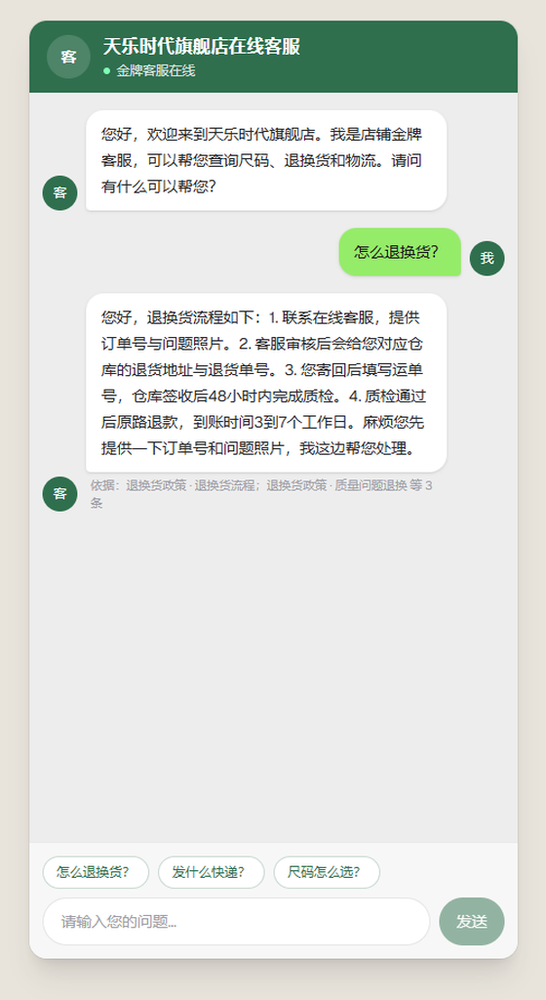

# AI 跨境智能客服 · AI Cross-border Customer Service

> 面向跨境电商店铺的 AI 客服助理：把高频、重复、多语言的售前售后咨询交给模型承接，人工只处理复杂问题与情绪化投诉。
>
> A Next.js AI customer-service agent for cross-border e-commerce stores.


---

## 界面预览

<p align="center">
  
</p>

---

## 1. 项目定位

跨境电商店铺的客服成本，本质上由三件事撑起来：

| 成本项 | 具体表现 |
| --- | --- |
| **人力覆盖** | 时差导致 7×24 排班，夜间与周末咨询响应慢、转化流失 |
| **语言壁垒** | 面向欧美、东南亚多市场需要多语种坐席；客单价低的小单摊不平人工成本 |
| **重复劳动** | 尺码、退换货政策、物流时效这类高度重复的咨询占据大部分接待量 |

本项目的思路是**把客服接待拆成两段**：能被标准化的问答交给模型自动承接，需要判断力、情绪安抚、订单核查的部分留给人工。先用最小的架构跑通"模型接客"这条链路，再逐步用知识库、转人工和评测机制去压低错误率。

### 目标指标

> 以下为项目设定的度量目标，**尚未实测**，后续迭代中会持续校准。

| 指标 | 目标 |
| --- | --- |
| 首次响应时间 | < 3s（流式首 token） |
| 标准问题自动解决率 | ≥ 70% |
| 人工介入率 | ≤ 30% |
| 幻觉率（评测集事实错误占比） | < 2% |

### 实测基线

`scripts/measure-latency.mjs` 直接调用 DeepSeek API，采样 10 次（另含 1 次预热以排除 TLS 握手开销）：

| 指标 | 实测值 |
| --- | --- |
| 首 token 延迟（中位数） | **352 ms** |
| 首 token 延迟（p90） | 612 ms |
| 首 token 延迟（最快 / 最慢） | 237 ms / 612 ms |
| 整段生成耗时（中位数） | 1358 ms |

> 口径说明：以上为服务端直连模型 API 的耗时，**不含**浏览器渲染与 Next.js 路由开销（实际用户感知约增加数十毫秒）。复现方式见 [`scripts/measure-latency.mjs`](./scripts/measure-latency.mjs)。

### 检索质量评测

[`scripts/eval.mjs`](./scripts/eval.mjs) 内置 40 条评测样本（32 条知识库内问题、8 条越界问题），用于回归检索与判定逻辑：

| 指标 | 结果 |
| --- | --- |
| 判定准确率（该答则答 / 该拒则拒） | **40/40 · 100%** |
| Top-1 定位（命中文档是否正确） | 32/32 · 100% |
| Hit@3 召回 | 32/32 · 100% |
| 拒答准确率（越界问题是否正确转人工） | 8/8 · 100% |

> **这组数字需要打折看**：评测集与阈值都是我对着同一批样本调的，属于典型的过拟合。真实上线前应当从线上会话日志抽样 100 条以上真实提问做留出验证，再对外报数。写在这里是为了可复现，而不是当作线上指标。

复现：`node scripts/eval.mjs`（离线，秒级）；加 `--live` 追加回答层评测（逐条调用 DeepSeek，校验关键事实是否出现在回复中）。

## 2. 已实现能力（当前版本）

- **移动端优先的会话界面**：微信客服风格的居中卡片布局，窄屏全宽、宽屏留白收缩，容器高度跟随视口。
- **流式输出**：基于 token 的渐进渲染，首字延迟感知明显低于整段返回；等待期间展示三点打字动画，而非空屏。
- **高频问题快捷入口**：退换货、物流、尺码三个按钮一键提问，降低用户输入成本。
- **角色化 System Prompt**：固定为宠物用品跨境电商的金牌客服人设，覆盖尺码推荐、退换货政策、物流进度三类意图。
- **知识库检索（RAG 第一版）**：5 篇店铺知识文档（退换货、物流、尺码、商品、售后）经结构化切分构建 26 条索引，回答前先检索，只把命中的片段喂给模型。
- **幻觉闸门**：BM25 分数与实词覆盖率双阈值判定，未达标时切换为「转人工」约束，禁止模型凭记忆编造价格、时效与政策。
- **回答可溯源**：每条回复下方展示「依据：文档 · 小节」，悬停可见命中的 chunk id 与检索分数；未命中时显示「已转人工」。出现错误回答时，可以立刻分清是**检索错**还是**生成错**。
- **未知问题兜底**：遇到具体订单号、物流单号这类模型无法确知的信息时，引导用户提供订单号或转接人工，而不是编造答案。
- **异常降级**：请求失败时展示可重试提示，不破坏已有会话上下文。
- **密钥不落前端**：模型调用全部在 Route Handler 内完成，浏览器侧拿不到 API Key。

## 3. 技术选型与权衡

| 层次 | 选型 | 选择理由 | 代价与约束 |
| --- | --- | --- | --- |
| 应用框架 | **Next.js 16（App Router）** | 前后端同仓，Route Handler 天然把模型调用挡在服务端；相比自建 Express + 前端仓库少维护一层服务，相比纯 SPA 又不需要额外网关 | 绑定 Node 运行时；需明确 Server / Client Component 边界 |
| UI 层 | **React 19** | 生态与组件复用度最高，AI SDK 提供官方 `useChat`，会话状态、流式增量、错误态都由 hooks 托管 | 客户端组件体积，需按需标记 `"use client"` |
| 模型接入 | **Vercel AI SDK 7 + DeepSeek** | 统一的流式消息协议（`UIMessage`）与 `streamText`，换模型只改一行；DeepSeek 中文客服口吻自然、单价低，适合高频短会话 | 存在厂商依赖风险，故把模型调用收敛在 `app/api/chat/route.ts` 单点，便于切换 OpenAI / Claude |
| 检索层 | **自实现 BM25 + 覆盖率闸门** | 客服查询高度依赖精确词（型号 `TL-DW-M`、政策名「7 天无理由」），BM25 在这类匹配上优于纯语义；零依赖、零延迟、可离线。同时 DeepSeek 无 embedding 接口，接向量需引入第二家供应商 | 不理解同义改写，后续需补向量检索做混合 |
| 样式 | **Tailwind CSS 4** | 原子类快速还原气泡、头像、快捷按钮等聊天高频组件，避免 CSS 文件膨胀 | 类名较长，复杂组件建议抽组件而非堆类名 |
| 语言 | **TypeScript** | `UIMessage` 贯穿前后端，减少消息协议漂移 | 初始开发成本略高 |
| 部署 | **Vercel** | 零配置接入 Git 仓库，环境变量托管，PR 自带预览环境 | 公开演示需配置额度与限流，否则密钥会被刷 |

**为什么是 Next.js 而不是别的：** 这个项目的形态是"一个页面 + 一个模型接口"，不需要重型后端。Next.js 用同一个仓库同时交付 UI 和接口，构建与冷启动都比传统"前端打包 + 独立服务端"方案更轻；同时 React 生态让聊天 UI、Markdown 渲染、无障碍等能力可以按需插拔，而不用自己造轮子。

## 4. 架构

```
浏览器 (React 19 + @ai-sdk/react useChat)
   │  POST /api/chat   { messages: UIMessage[] }
   ▼
Next.js Route Handler   app/api/chat/route.ts
   │
   ├─► 知识库检索   lib/knowledge/  （BM25 + 实词覆盖率双闸门）
   │      ├─ 命中   → 拼装【参考资料】+ 强约束提示词
   │      └─ 未命中 → 切换为「转人工」约束，禁止生成事实性内容
   │
   │  streamText({ model: deepSeek("deepseek-chat"), system, messages })
   ▼
DeepSeek API
   │  token stream
   ▼
toUIMessageStreamResponse()  ──►  浏览器增量渲染
```

链路分两段：**先检索决定"能不能答"，再生成决定"怎么答"**。检索未命中时模型拿不到任何事实素材，只能引导用户提供订单号或转人工——这是比在提示词里写「不要编造」更硬的约束。

## 5. 快速开始

环境要求：Node.js ≥ 20

```bash
git clone https://github.com/ftlztmds/ai-customer-service.git
cd ai-customer-service
npm install
```

创建 `.env.local`（可使用仓库内的 `.env.example` 作为模板）：

```bash
DEEPSEEK_API_KEY=your_deepseek_api_key_here
```

从 [DeepSeek 开放平台](https://platform.deepseek.com/) 获取 Key 后启动：

```bash
npm run dev     # http://localhost:3000
```

生产构建：

```bash
npm run build && npm start
```

## 6. 目录结构

```
app/
├── api/chat/route.ts    # 检索 + 模型调用 + 流式响应（唯一持有密钥的入口）
├── layout.tsx           # 根布局、字体与 metadata
├── page.tsx             # 客服会话界面（客户端组件）
└── globals.css          # Tailwind 入口与全局样式
lib/knowledge/
├── chunk.ts             # Markdown → chunk 切分
├── scorer.ts            # BM25 打分与覆盖率计算（纯函数，可被脚本复用）
└── retrieve.ts          # 索引加载与双闸门判定
lib/chat/
├── types.ts             # 前后端共用的消息元数据类型
└── prompt.ts            # 提示词装配（线上与评测共用，避免两套逻辑漂移）
data/knowledge/
├── *.md                 # 知识库原文：退换货 / 物流 / 尺码 / 商品 / 售后
└── index.json           # 构建产物，随仓库提交，避免运行时切分
data/eval/
├── questions.json       # 40 条评测样本
└── latest-report.json   # 最近一次评测结果
scripts/
├── build-knowledge.mjs  # 重建知识库索引
├── query-knowledge.mjs  # 检索调试与阈值回归
├── eval.mjs             # 40 条评测集回归（--live 跑回答层）
└── measure-latency.mjs  # 首 token 延迟基准
public/                  # 静态资源
```

## 7. 路线图

### v0.2 多语言客服（翻译层）

跨境电商最难的不是回答，而是**用对方的语言回答**。

- 自动语种识别：用户用母语提问，模型以同一语言回复，无需用户手动切换
- 双语对照：面向商家的视角同时给出中文原文，便于客服复核话术质量
- 术语表约束：SKU 名、尺码表、品牌词建立固定译法表，避免尺码/材质翻译错导致退货
- 首批目标语种：英语、西班牙语、法语、德语、日语

### v0.3 知识库与检索增强（RAG）

纯 prompt 客服无法回答"这条牵引绳 M 码适合多大胸围"这类依赖具体商品数据的问题。

**已完成**

- 5 篇知识文档入库（退换货政策 / 物流配送 / 尺码规格 / 商品清单 / 售后服务），按「## 小节」切分为 26 条 chunk
- 切分策略：政策按条款切、SKU 一行一条不切断、文档级元信息（适用范围/生效日期）不进检索正文
- BM25 检索（中文用单字 + 二元组切分，不引入分词词典）+ 短语命中加权
- 双闸门判定：`BM25 分数 ≥ 2.5` 且 `实词覆盖率 ≥ 33%`，不达标一律转人工
- 检索调试脚本 `scripts/query-knowledge.mjs`，改阈值前先跑回归

**下一步**

- 向量检索：DeepSeek 无 embedding 接口，需接入第二家供应商（如 bge-m3 / text-embedding-v3），与 BM25 做混合检索 + rerank
- 依据可点击：点击「退换货政策 · 各市场退货差异」直接展开该段原文
- 知识库管理后台：PDF / Excel 导入、增量更新与版本化，改政策不用改代码

### v0.4 幻觉治理（长期迭代）

这是这类项目真正的护城河——**能说"不知道"比答得快更重要**。

**已完成**

- 检索约束：无检索命中时禁止生成事实性内容（价格、时效、政策）
- 置信度双阈值：分数或覆盖率不达标直接转人工，不硬答
- 40 条评测集 + 回归脚本，每次改阈值/知识库后跑一遍，记录判定准确率与拒答率

**下一步**

- 扩到 100+ 条真实会话样本，并切分「开发集 / 留出集」，避免对着同一批样本调参造成的过拟合
- 回答层自动校验关键事实是否出现，把「事实准确率 / 幻觉率」纳入每次发布的检查项
- 人工纠错回流：客服标记错答 → 进入评测集与提示词迭代，形成闭环

### v0.5 工程化

- 会话持久化、工单系统与转人工队列
- 限流、鉴权与按 token 的成本监控
- 可观测性：Langfuse 追踪 prompt、耗时、单次会话成本

## 8. 安全与合规

- API Key 仅存放于服务端环境变量，`.gitignore` 已排除 `.env*`
- 公开演示环境需加限流与密钥额度上限——公开仓库的 demo 极易被爬虫盗刷
- 当前未接入任何真实订单、地址、支付数据；接入前需做字段脱敏与访问审计

## 9. 说明

- 演示店铺「天乐时代旗舰店」及相关商品信息为虚构，仅用于展示交互
- 本项目为个人作品，用于验证"AI 客服承接重复人力"的可行性与工程落地方式

## License

[MIT](./LICENSE)

---

### Summary (English)

A cross-border e-commerce customer-service agent built with Next.js 16 (App Router), React 19, Tailwind CSS 4 and the Vercel AI SDK streaming from DeepSeek. It handles high-frequency inquiries (sizing, returns, shipping) with token-level streaming, guides unknown questions to a human handoff instead of hallucinating, and keeps the API key server-side. Roadmap: multilingual translation layer, RAG over product knowledge base, and a hallucination-evaluation loop.
